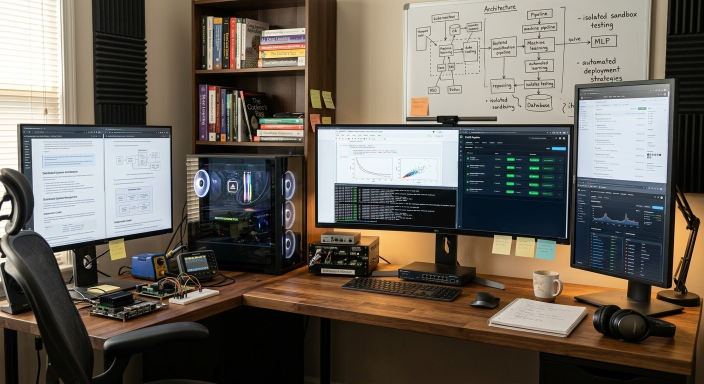

# Autonomous Tech & Infrastructure Platform

An integrated self-study and autonomous R&D engine uniting full-stack software engineering, cloud infrastructure, AI/ML orchestration, and cybersecurity.

​================================================================================
          🤖 AUTONOMOUS TECH & INFRASTRUCTURE PLATFORM 🚀
================================================================================

--------------------------------------------------------------------------------
 📊 SYSTEM ARCHITECTURE DIAGRAM
--------------------------------------------------------------------------------

      +-------------------------------------------------------+
      |               GitHub Code Repository                  |
      +-------------------------------------------------------+
                                  │
                                  ▼
      +-------------------------------------------------------+
      |             GitHub Actions Workflows                  |
      |   (Advanced CI, CodeQL, Nightly Scout, Security Audit)|
      +-------------------------------------------------------+
            │                     │                     │
            ▼                     ▼                     ▼
     [ Build & Push ]     [ Static Analysis ]    [ Scout & Test ]
            │                     │                     │
            +---------------------+---------------------+
                                  │
                                  ▼
      +-------------------------------------------------------+
      |              Docker Sandbox Engine                    |
      |          (Isolated execution & cleanups)              |
      +-------------------------------------------------------+
                                  │
                                  ▼
      +-------------------------------------------------------+
      |           Streamlit Control Dashboard                 |
      +-------------------------------------------------------+

--------------------------------------------------------------------------------
 💡 WHAT IS THIS ABOUT?
--------------------------------------------------------------------------------
Imagine having a super-smart robot helper that builds computer programs, checks 
them for sneaky bugs, and keeps everything safe all by itself! This project is a 
futuristic computer system that acts like an automated helper for coding, 
testing, and protecting software without needing a human to do all the boring 
chores.

--------------------------------------------------------------------------------
 ⚙️ WHAT THIS DOES?
--------------------------------------------------------------------------------
• 🏗️ Builds things automatically: It creates software packages (Docker 
  containers) and sends them where they need to go.
• 🔍 Hunts for bugs: It scans your code to make sure there are no security 
  traps or bad guys hiding inside.
• 🕵️ Explores repositories: A special helper called "Scout Bot" looks at other 
  projects to see what's new.
• 📊 Shows you cool dashboards: It has a fun control panel where you can click 
  buttons to run tests and see what the robots are doing.

--------------------------------------------------------------------------------
 🔄 HOW THIS WORKS?
--------------------------------------------------------------------------------
It works like a team of tiny digital workers:
1. ⏰ GitHub Workflows act like alarm clocks that wake up the system to test 
   and check the code.
2. 🛡️ Docker Sandboxes act like safe, enclosed playgrounds where the computer 
   can run weird or experimental code without breaking your actual computer.
3. 🐍 Python Scripts do the heavy lifting behind the scenes—handling web 
   requests, saving reports, and organizing files.

--------------------------------------------------------------------------------
 🧭 STEP-BY-STEP GUIDE
--------------------------------------------------------------------------------
1. 📥 Clone or Download the project files onto your computer.
2. 💻 Make sure you have Docker and Python installed.
3. ⌨️ Open your terminal and type the magic command: docker-compose up --build
4. 👀 Watch the engine start up, build your containers, and launch your 
   dashboard!

--------------------------------------------------------------------------------
 ⭐ WHY IS THIS COOL? (15 REASONS)
--------------------------------------------------------------------------------
1. 🤖 It works all by itself: Like magic, it runs tasks without you having to click around.
2. 🛡️ Super safe sandbox: It lets you test wild code in a closed box so it can't escape and cause trouble.
3. 🕵️ Scout Bot helper: It automatically checks other repositories to keep you updated.
4. 🔒 Automatic security guards: Tools like Bandit and CodeQL hunt down security problems for you.
5. 🌙 Nightly wake-up calls: It checks your code every single night while you sleep.
6. 🧹 Cleans up after itself: The cleanup scripts throw away old, junk containers so your computer doesn't get cluttered.
7. 📈 Cool dashboards: You get a nice Streamlit control panel to see your app's status instantly.
8. ⚡ Saves you tons of time: No more manual testing or building!
9. 🐳 Speaks container language: It uses Docker to package apps neatly.
10. 📂 Organized rooms: The project folder is neatly sorted into special folders for backend, frontend, security, and AI.
11. 🗄️ Database buddy: It uses SQLAlchemy to keep track of information in a neat database.
12. 🚀 FastAPI power: It handles web traffic super fast.
13. 📄 Generates neat reports: It writes down everything it finds into JSON report files.
14. 🔄 Always improving: The CI/CD pipeline tests and pushes updates smoothly.
15. 👑 Makes you feel like a boss: You get to run your own autonomous tech empire!

--------------------------------------------------------------------------------
 🧩 WHAT PROBLEMS THIS SOLVES? (15 SOLUTIONS)
--------------------------------------------------------------------------------
1. Problem: Forgetting to test your code.
   ➔ Solution: Automated tests run every time you update your project.
2. Problem: Hidden security bugs making your app unsafe.
   ➔ Solution: Security auditors catch vulnerabilities early.
3. Problem: Computer running out of space from old test files.
   ➔ Solution: Sandbox cleanup scripts tidy up dangling containers automatically.
4. Problem: Manual deployments taking too long.
   ➔ Solution: CI/CD pipelines build and push Docker images instantly.
5. Problem: Missing out on updates in other repositories.
   ➔ Solution: Scout Bot checks them for you on a schedule.
6. Problem: Untrusted code crashing your main system.
   ➔ Solution: Isolated Docker sandbox environments keep things contained.
7. Problem: Boring, confusing paperwork and logs.
   ➔ Solution: Automatic report generation formats data neatly.
8. Problem: Hard-to-read text data.
   ➔ Solution: A visual Streamlit dashboard makes data easy to look at.
9. Problem: Messy code organization.
   ➔ Solution: A clean modular folder structure keeps everything in its place.
10. Problem: Forgetting to run routine checks.
    ➔ Solution: Cron-job workflows run checks every day at UTC time.
11. Problem: Hard database setups.
    ➔ Solution: Built-in models handle database tables automatically.
12. Problem: Slow API responses.
    ➔ Solution: FastAPI backend handles web requests like a champ.
13. Problem: Network privacy worries.
    ➔ Solution: WireGuard tunnel configurations keep your connection private.
14. Problem: Tedious code reviews taking days.
    ➔ Solution: Automated scripts review code in seconds.
15. Problem: Feeling overwhelmed by big projects.
    ➔ Solution: Clear documentation and structured tasks make it super easy to understand.

--------------------------------------------------------------------------------
 🛠️ HOW TO INSTALL THIS?
--------------------------------------------------------------------------------
Run this command in your terminal where the project is saved:
docker-compose up --build

--------------------------------------------------------------------------------
 📦 REQUIREMENTS?
--------------------------------------------------------------------------------
• 🐍 Python 3.11+
• 🐳 Docker & Docker Compose
• 📋 Packages listed in requirements.txt:
  - FastAPI
  - Uvicorn
  - Requests
  - PyYAML
  - Pytest
  - Bandit
  - Pydantic
  - SQLAlchemy
  - Streamlit
  - Docker Python SDK

--------------------------------------------------------------------------------
 🌳 PROJECT STRUCTURE TREE
--------------------------------------------------------------------------------
.
├── .github/
│   └── workflows/
│       ├── advanced_ci.yml
│       ├── codeql.yml
│       ├── nightly_scout_and_test.yml
│       └── security-audit.yml
├── docker/
│   ├── Dockerfile.sandbox
│   ├── Dockerfile.scout
│   ├── cleanup-sandbox.sh
│   └── entrypoint.sh
├── src/
│   ├── ai_infra/
│   │   ├── kserve_deployer.py
│   │   ├── ray_cluster.py
│   │   └── slm_orchestrator.py
│   ├── backend/
│   │   ├── api_gateway.py
│   │   └── models.py
│   ├── core/
│   │   └── engine.py
│   ├── frontend/
│   │   └── dashboard.py
│   ├── privacy/
│   │   └── wireguard_tunnel.py
│   ├── sandbox_runner/
│   │   └── sandbox_runner.py
│   ├── scout_bot/
│   │   └── scout_bot.py
│   └── security/
│       └── auditor.py
├── tests/
│   ├── test_backend.py
│   ├── test_sandbox.py
│   ├── test_scout.py
│   └── test_security.py
├── Dockerfile
├── docker-compose.yml
├── requirements.txt
└── README.md
